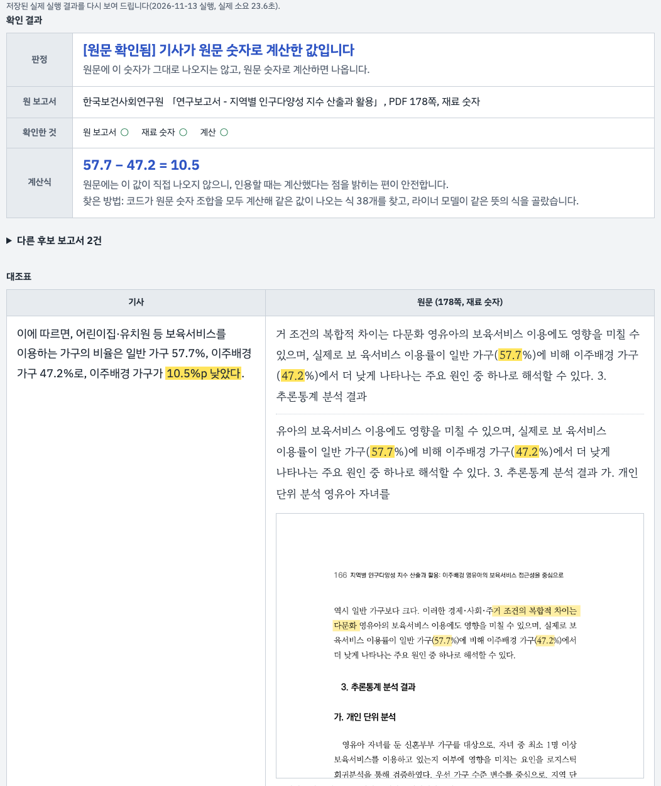
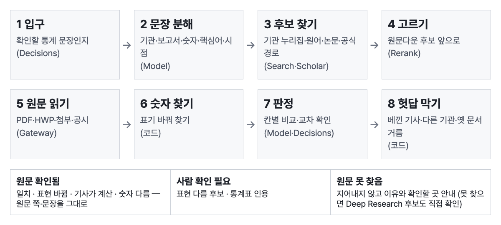
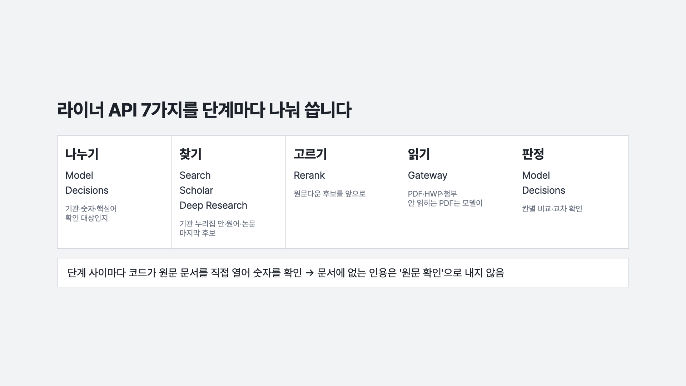

# 원래 어디서? — 기사 속 숫자의 원문을 문장까지 찾아 주는 AI 에이전트

> 라이너 .EXE-THON 2026 출품 기획서 · 2026-11-16
> 심사 항목 순서로 썼습니다: 문제 정의(30) · 해결 방법과 완성도(30) · 라이너 API 활용(20) · 확장성·임팩트(20)

---

## 0. 한 장 요약

**한 문장 정의.** 숫자가 든 기사 문장을 넣으면 그 숫자를 처음 낸 원문을 찾습니다. 원문은 보고서 PDF, 보도자료, 공시, 통계표, 논문 가운데 하나입니다. 원문 문장을 그대로 보여 주고, 기사가 원문을 어떻게 옮겼는지(그대로 / 표현을 바꿈 / 기사가 계산함 / 숫자가 다름) 알려 줍니다.

**누가, 언제 씁니까.** 보고서, 제안서, 기사에 남의 숫자를 옮겨 쓰는 사람이 인용 직전에 씁니다. 기자, 정책·연구 실무자, 공공기관 홍보 담당, 기업 리서치 담당이 그 대상입니다.

**성적(처음 보는 문장, 보면서 고치기 전 첫 측정).** 인용 장면은 문장에 기관·보고서 이름이 나오는 인용 문장입니다.

| 지표 | 목표 | 인용 장면 2세트 합계 | 무작위 기사 3세트 합계(참고) |
|---|---|---|---|
| ① 틀린 단정: 원문 확인 없이 '일치'나 '원문에 없음'이라고 단정한 수 | 40건당 0~1건 | **0건 / 60문장** | 3건 / 100문장 |
| ② 원문 문장 확인: 공개 원문이 있는 문장 중 원문의 그 문장까지 찾은 비율 | 50% 이상 | **13/21 (62%)** | 29/51 (57%) |
| ③ 쓸모 있는 답: 원문을 찾았거나, 원문이 공개되지 않은 종류임을 바르게 안내했거나, 확인할 위치를 알려 준 비율 | 80% 이상 | **40/49 (82%)** | 68/88 (77%) |
| 한 건 걸린 시간(지금 코드) | — | 중앙값 33초 | 중앙값 46초 |

- **같은 문장을 라이너 Deep Research에 넣은 비교**(인용 장면 30건 중 공개 원문이 있는 19건): 원문 문장까지 맞힌 수는 **우리 12건, Deep Research 8건**이었습니다. Deep Research가 맞힌 8건은 우리도 모두 맞혔습니다.
- **반복해서 고친 뒤**(개발 세트로 바뀐 세트, 참고값): 인용 장면 3회 평균 기준으로 ② 73%, ③ 84%, ① 0건입니다.

**대표 화면.** 기사 문장을 넣으면 원 보고서의 쪽·문장을 찾아 나란히 보여 줍니다(아래: 기사가 계산한 숫자의 재료를 178쪽에서 찾은 예).

**링크.** 저장소 https://github.com/babymir/wonrae-eodiseo · 데모 영상: 함께 제출한 파일(원래어디서_시연영상.mp4, 2분 50초)

---

## 1. 문제 정의 (30)

### 1-1. 직접 겪은 문제

- 어떤 기사에 "정규직과 비정규직 임금 격차 **194만 원**, 역대 최대"라는 문장이 있었습니다. 원 통계 보도자료를 찾아보니 194만 원이라는 숫자는 어디에도 없었습니다. 기자가 두 숫자(405.2만 원 − 211.2만 원)를 직접 뺀 값이었습니다. 계산은 맞았습니다. 하지만 이 사실을 알려면 원문을 열어 숫자 두 개를 찾아야 했습니다.
- 다른 사람의 제안서를 인용하다가, 원 보고서에서 '확률'이 아니라 '위험비율'이라는 다른 지표였다는 것을 발견한 적도 있습니다. 숫자는 그대로인데 뜻이 바뀌어 있었습니다.
- 기사에는 원문 링크가 거의 없습니다. 기관 누리집에서 보고서를 찾고, 첨부 HWP·PDF를 열고, 쪽을 넘겨 숫자를 찾으려면 **숫자 하나에 30분 넘게** 걸립니다. 그래서 바쁠 때는 확인하지 않고 옮겨 씁니다. 틀린 숫자는 그렇게 퍼집니다.

### 1-2. 누가 겪는가

- **보도자료·보고서를 쓰는 실무자**(예: 공공기관 홍보 담당, 2년 차)
  - 상황: 다른 기관 통계를 인용하는 일이 한 주에 여러 번 있습니다.
  - 지금 하는 방법: 기사를 검색합니다. 기관 누리집 게시판에서 첨부 파일을 찾습니다. PDF를 열어 Ctrl+F로 찾습니다. 그래도 못 찾으면 기사 숫자를 그대로 씁니다.
  - 걸리는 시간: 숫자 하나에 20~40분입니다. 원문을 못 찾는 경우도 많습니다.
- **기자·편집자**: 송고 직전에 남의 기사가 인용한 숫자를 다시 확인해야 하는 사람입니다.

### 1-3. 왜 지금, 왜 기존 도구로는 안 되는가

- **범용 AI 검색은 원문 대신 사본을 인용하고, 모르면서도 답합니다.** Tow Center(2025-03)가 AI 검색 8종을 시험한 결과 오답률이 60%를 넘었고, 지어낸 주소와 깨진 주소가 많았습니다.
- **기자는 AI를 쓰지만 사실 확인에는 잘 쓰지 않습니다.** 한국 기자의 AI 사용률은 58.1%였지만, 그중 사실 확인에 쓴다는 응답은 23%였습니다(한국언론진흥재단, 2025).
- **원문 쪽·문장까지 가는 제품이 없습니다.** 비슷한 서비스 31개를 조사했지만, 다음 네 가지를 한 번에 하는 곳은 찾지 못했습니다. 근거는 `reports/원래 어디서 유사 서비스 조사.md`입니다.
  1. 1차 원문의 문장 위치
  2. 표현이 바뀐 유형 판정
  3. 기사가 계산한 숫자의 재료 찾기
  4. 한국 공공 문서(HWP·첨부·공시) 지원
- 국가데이터처가 2027~2028년에 'AI 오보 검증 시스템'을 만들 계획입니다. 하지만 대상은 공식 통계 DB로 한정됩니다. 우리는 연구원 보고서, 보도자료, 공시, 해외 기관 문서까지 다룹니다.

### 1-4. 숫자는 이렇게 바뀝니다(실제로 찾은 유형)

| 유형 | 실제 예 | 우리 판정 |
|---|---|---|
| 기사가 계산 | 보육 이용률 일반 가구 57.7%, 이주배경 가구 47.2% → 기사 "10.5%p 낮다" | 기사가 계산(재료 숫자 2개를 보여 줌) |
| 지표·단위가 바뀜 | IEA 보고서 'Gulf oil exports 18.4 mb/d' → 기사 '석유 공급량 하루 1840만 배럴' | 표현 바뀜 |
| 다른 출처를 원문으로 착각 | 등록청 자료를 인용한 연구단체 보고서를 원문으로 쓴 경우 | 원출처 미확인(다른 기관 문서는 원문으로 내지 않음) |
| 원문이 공개 문서가 아님 | 오피넷 유가, 의원실 제출 자료, 시세 | 확인할 곳 안내 |

---

## 2. 해결 방법과 완성도 (30)

### 2-1. 흐름

1. **입구**: 확인할 통계 문장인지 가립니다. 의견, 계획, 조사 방법만 있는 문장은 '확인 대상 아님'으로 돌려보냅니다.
2. **문장 분해**(라이너 모델): 기관, 보고서 이름, 숫자, 핵심어, 기준 시점, 기관 누리집, 원어 검색어를 뽑습니다.
3. **원문 후보 찾기**
   - 라이너 웹 검색: 기관 누리집 안, 원어, 파일 형식으로 검색합니다.
   - 라이너 Scholar: 논문을 찾습니다.
   - 공식 경로: 정책브리핑 보도자료, DART 공시, 여론조사심의위 등록 결과.
   - 해외 기관은 영문 이름으로 누리집을 찾은 뒤, 첫 화면에서 새 글을 따라갑니다.
4. **후보 고르기**(라이너 Rerank): 제목과 검색 요약으로 원문다운 후보를 앞에 둡니다.
5. **원문 읽기**: PDF, HWP, HWPX, 엑셀, 웹 페이지, 게시물 첨부(자바스크립트 다운로드 버튼 포함), 공시 표를 읽습니다. 글자로 안 읽히는 PDF는 라이너 게이트웨이 모델이 직접 읽습니다.
6. **숫자 찾기**: 표기를 바꿔 가며 찾습니다(1,784원 ↔ 1784원, 3만5천787건 ↔ 35,787, 1840만 배럴 ↔ 18.4 mb/d, 억 단위 반올림). 핵심어가 같은 문장인지도 확인합니다.
7. **판정**(라이너 모델 + Decisions): 원문 문장과 기사 문장을 지표, 대상, 시점, 비교 기준, 수준 칸으로 나눠 비교합니다.
8. **헛답 막기 점검**(코드 규칙): 다음 경우에는 '원문 확인'으로 내지 않습니다.
   - 베낀 기사
   - 다른 기관 문서
   - 기준 연도보다 먼저 나온 문서
   - 기준값으로만 맞춘 숫자
9. **못 찾으면**: 왜 없는지 설명하고(시세 화면, 여론조사, 의원실 자료, 국가통계 원자료) 확인할 곳을 알려 줍니다. 1차에서 못 찾으면 중간 답을 먼저 보여 주고, 뒤에서 계속 찾습니다.

### 2-2. 결과 종류(화면에서 세 묶음)

| 묶음 | 판정 | 화면에 보이는 것 |
|---|---|---|
| 원문 확인됨 | 일치 / 표현 바뀜 / 기사가 계산 / 숫자 다름 | 원문 주소, 쪽, 원문 문장, 기사 문장과의 칸별 비교 |
| 사람 확인 필요 | 표현 다름 후보 / 통계표·원자료 인용 | 같은 숫자인데 표현이 다른 원문 문장, 통계표 위치 |
| 원문 못 찾음 | 원출처 미확인 / 확인 대상 아님 | 지어내지 않고 이유와 확인할 곳을 안내 |

### 2-3. 설계 원칙: 틀린 것을 맞다고 하지 않는다

- 모델이 "찾았다"고 해도 **원문 문서를 직접 받아 그 안에서 숫자를 찾은 경우에만** '원문 확인'으로 냅니다. Deep Research가 지어낸 인용(문서에 없는 문장)을 실제로 확인한 뒤 정한 원칙입니다.
- 확인하지 못한 문서를 근거로 '원문에 없음'이라고 단정하지 않습니다.
- 자동 접속을 막은 누리집은 우회하지 않습니다.
- 헛답을 막는 규칙은 실제 사례 26개로 오프라인 테스트합니다(`도구/테스트_헛답막기.py`). 숫자 표기 변환은 39개로 테스트합니다(`도구/테스트_숫자표기.py`). 둘 다 API 없이 몇 초 안에 끝납니다.

### 2-4. 평가 방법(정직한 성적표)

- **정답표는 도구를 쓰지 않고 만들었습니다.** 에이전트가 웹 검색만으로 원문을 찾아 정답표를 만들었습니다. 분류는 원문 있음 / 원문 비공개 / 확인 대상 아님 / 모름입니다.
- **채점은 판정 이름이 아니라 근거 문서로 합니다.** 근거 문서가 정답 원문과 같은지 대조합니다. 주소가 다르면 사람이 직접 열어 '같은 원문 / 다른 출처 / 틀린 근거'로 판단하고 기록합니다(`정답찾기/근거확인.json`).
- **헤드라인은 처음 보는 문장의 첫 측정입니다.** 세트를 모은 뒤 코드를 고치기 전에 처음 돌린 결과입니다.

| 세트(수집 방법) | 문장 | ① 틀린 단정 | ② 원문 문장 확인 | ③ 쓸모 있는 답 |
|---|---|---|---|---|
| 인용 장면 I | 30 | 0 | 6/10 (60%) | 21/26 (81%) |
| 인용 장면 J | 30 | 0 | 7/11 (64%) | 19/23 (83%) |
| **인용 장면 합계** | **60** | **0** | **13/21 (62%)** | **40/49 (82%)** |
| 무작위 F† | 40 | 1 | 9/19 (47%) | 27/32 (84%) |
| 무작위 H | 30 | 1 | 12/16 (75%)* | 18/28 (64%) |
| 무작위 B | 30 | 1 | 8/16 (50%) | 23/28 (82%) |

† 무작위 F는 측정 뒤 정답표 정정 1건(#8)과 근거 문서 사람 확인 6건을 반영한 값입니다. 처음 기록(8/19, 23/32)보다 조금 높습니다. 코드는 바꾸지 않았습니다.
\* 무작위 H는 원문 있는 16건 중 8건이 같은 미국 노동통계국 발표입니다. 이 8건을 빼면 4/8(50%)입니다.

- 무작위 기사에서 나온 틀린 단정 3건은 원인을 찾아 **일반 규칙으로 막았습니다.** 막은 규칙은 다음과 같습니다.
  - 숫자 기준값('0.08% 이상')만 맞춘 경우
  - 2011년 표 줄을 근거로 쓴 경우
  - 다른 기관 보고서를 근거로 쓴 경우

  규칙을 넣기 전에 지금까지의 결과 전체에 대 보고, 맞게 찾은 답이 걸리지 않는 것을 확인했습니다.
- **흔들림도 쟀습니다.** 같은 60문장을 저장된 답 없이 3번 돌렸습니다. 인용 장면 ②는 64% → 73% → 82%, 무작위 ③은 82% → 86% → 89%였습니다. 원문 있는 문장의 판정은 회차마다 나아지는 쪽으로만 바뀌었습니다. 다만 이 세트는 이제 보면서 고친 세트라 참고값으로만 씁니다.
- **아직 못 잰 것**: 한 번도 돌리지 않은 최종 세트 90건(인용 장면 60 + 무작위 30)이 있습니다. 정답표까지 만들어 두었지만 대회 크레딧을 다 써서 측정하지 못했습니다. 결선 전에 크레딧이 주어지면 이 세트로 다시 재서 공개하겠습니다.

### 2-5. 한계(먼저 밝힘)

- 원문이 공개 문서가 아닌 숫자는 찾을 수 없습니다. 시세, 유료 자료, 관계자 발언, 의원실 제출 자료가 그렇습니다. 이런 숫자는 '확인할 곳'으로 안내합니다.
- 조회 화면 안의 숫자는 아직 숫자까지 확인하지 못합니다. 오피넷, KOSIS 통계표, 한국부동산원 주간 동향이 그렇습니다.
- 검색 색인에 없는 게시물, 자바스크립트로만 열리는 목록은 놓칠 수 있습니다.
- 한 건에 30~60초가 걸립니다(시간 상한 60초). 원문을 못 찾으면 중간 답을 먼저 보여 줍니다.

---

## 3. 라이너 API 활용 (20)

| 단계 | 라이너 API | 하는 일 | 건당 평균 호출* |
|---|---|---|---|
| 입구·판정 교차 확인 | Decisions | 확인 대상인지, 같은 지표인지 확률로 판별 | 0.6 |
| 문장 분해 | Model(router) | 기관·보고서·숫자·핵심어·원어 검색어 추출 | 2.9 |
| 원문 후보 | Search(web), Scholar | 기관 누리집 안·원어·파일 형식·논문 검색 | 11.8 |
| 후보 순위 | Rerank | 제목·요약으로 원문다운 후보를 앞에 둠 | 4.7 |
| 원문 읽기 | Gateway(PDF) | 글자로 안 읽히는 PDF를 모델이 직접 읽음 | 0.5 |
| 판정 | Model(quality) | 칸별 비교, 기사가 계산한 식 고르기, 표현 다른 문장 찾기 | 4.6 |
| 마지막 후보 | Deep Research(agents) | 못 찾을 때 원 출처 주소만 받아 우리가 직접 확인 | 0.6 |

\* 처음 보는 60문장 첫 측정의 평균입니다.

**왜 Deep Research 하나에 맡기지 않습니까?** 같은 인용 문장 19건에서 Deep Research는 원문 문장을 8건 맞혔습니다. 정답 문서를 짚고도 숫자 인용이 없거나 틀린 경우가 5건, 다른 출처가 2건, 문서에 없는 인용이 1건이었습니다. 우리는 찾기(Search·Scholar), 고르기(Rerank), 읽기(Gateway), 판정(Model·Decisions)을 나누고, 그 사이에 코드로 원문을 직접 확인합니다. 그래서 12건을 맞혔고, 틀린 단정은 0건이었습니다. Deep Research는 버리지 않고 '마지막 후보 제공자'로 씁니다.

---

## 4. 확장성·임팩트 (20)

- **라이너 안에서**
  - 라이너 확장 프로그램: 기사 숫자를 드래그하면 '이 숫자 원문 보기'
  - 라이너 답변의 '문장 단위 출처'를 1차 원문 문장까지 내려 주는 기능
- **조직에서**
  - 언론사 데스크: 송고 전 숫자 점검
  - 공공기관 홍보실: 자기 통계를 잘못 인용한 기사를 찾아 설명자료로 대응
  - 기업 리서치: 보고서에 쓴 숫자의 원문 기록
- **출처를 늘리는 비용이 작습니다.** 기본 길은 기관 누리집 검색이라 기관마다 코드를 짜지 않습니다. 공식 경로는 작은 파일 하나씩입니다.

  | 공식 경로 | 코드 길이 |
  |---|---|
  | 여론조사심의위 | 97줄 |
  | 정책브리핑 | 98줄 |
  | 닐슨 시청률 | 34줄 |
  | DART 공시 | 340줄 |
- **공공적 의미**: 공공 통계가 바르게 인용되게 돕습니다. 범용 AI가 원문 대신 사본을 인용하는 문제도 보완합니다.
- **로드맵**
  1. 공식 API로 숫자를 직접 대조(KOSIS 통계표, DART 재무 API, 해외 통계청)
  2. 조회 화면 숫자 읽기
  3. 원문 찾기 결과를 쌓아 '자주 인용되는 숫자 → 원문' 색인 만들기

---

## 5. 부록

- **개발 기간**: 11/10에 손으로 시험했고(대회 전), 코드는 11/12부터 대회 기간에 썼습니다.
- **규모**: 파이썬 약 7,700줄, 커밋 60여 개, 오프라인 테스트 65개(숫자 표기 39, 헛답 막기 26)입니다.
- **실행 방법**: README를 보면 됩니다.
- **측정 기록**: `진행현황.md`(날짜별), 각 세트 폴더의 `평가결과*.json`, 채점은 `python3 도구/정답대조.py <세트 폴더>`입니다.
- **개발 중 성적 추이**(보면서 고친 세트, 정직하게 '개발 중'으로 표시): 처음 보는 기사 40건 첫 측정 25%(11/15) → 같은 방식 새 세트 47% → 인용 장면 60~64%(11/16).
