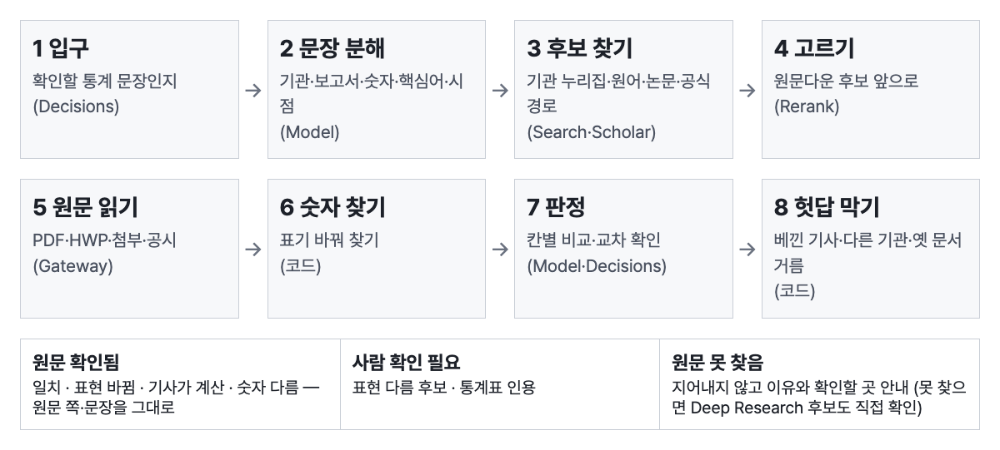

# 원래 어디서? — 기사 속 숫자의 원문을 문장까지 찾는 AI 에이전트

> 라이너 .EXE-THON 2026 기획서 · 저장소 github.com/babymir/wonrae-eodiseo · 데모 영상(함께 제출, 2분 40초) · 상세 기획서와 측정 기록은 저장소 `제출/기획서.md`

## 1. 누가, 어떤 문제로, 얼마나 불편한가

- **누가**: 보고서, 보도자료, 제안서, 기사에 남의 숫자를 옮겨 쓰는 사람입니다. 공공기관 홍보 담당, 정책·연구 실무자, 기자·편집자, 기업 리서치 담당이 여기에 해당합니다.
- **문제**: 기사에는 원문 링크가 거의 없고, 숫자는 옮겨지면서 바뀝니다.
  예를 들어 기사의 "정규직·비정규직 임금 격차 194만 원"은 원 통계에 없고, 기자가 두 숫자를 뺀 값이었습니다. 국제에너지기구(IEA)의 '수출량 18.4 mb/d'는 기사에서 '공급량 1840만 배럴'이 됐습니다.
- **얼마나 불편한가**: 원문을 확인하려면 기관 누리집을 뒤지고, 첨부 HWP·PDF를 받아 수백 쪽을 넘겨야 합니다. 숫자 하나에 30분이 넘게 걸립니다. 그래서 바쁠 때는 확인하지 않고 옮겨 쓰고, 틀린 숫자가 그렇게 퍼집니다.
- **기존 도구로는 안 됩니다**: AI 검색 8종은 뉴스 인용 출처 시험에서 오답이 60%를 넘었고, 원문 대신 사본과 기사를 인용했습니다(Tow Center, 2025). 비슷한 서비스 31개를 조사했지만, 1차 원문의 문장까지 찾고 기사가 바꾼 방식을 판정해 주는 제품은 찾지 못했습니다.

## 2. 에이전트의 해결 방식

숫자가 든 기사 문장 하나를 넣으면, 그 숫자를 처음 낸 원문을 찾아 **원문의 쪽과 문장을 기사 문장 옆에 나란히** 보여 줍니다. 원문은 보고서 PDF, 보도자료, 공시, 통계표, 논문 가운데 하나입니다.

- **틀린 것을 맞다고 하지 않습니다.** 모델이 "찾았다"고 해도, 원문 문서를 직접 받아 그 안에서 숫자를 찾은 경우에만 '원문 확인'으로 냅니다. 베낀 기사, 다른 기관 문서, 기준 연도보다 먼저 나온 문서는 코드 규칙으로 거릅니다(실제 사례 26개로 오프라인 테스트).
- **성적(처음 보는 문장, 보면서 고치기 전 첫 측정)**

| 처음 보는 인용 문장 60개 | 결과 |
|---|---|
| 원문 확인 없이 단정한 수(틀린 단정) | **0** |
| 원문 문장까지 찾음(공개 원문이 있는 21개 중) | **13개(62%)** |
| 쓸모 있는 답(원문 확인 또는 바른 안내) | **82%** |
| 같은 19문장에서 원문 문장 맞힘: 우리 vs 라이너 Deep Research | **12 vs 8** |

무작위 기사 100문장에서는 원문 문장 57%, 쓸모 있는 답 77%였습니다. 틀린 단정 3건은 원인을 찾아 일반 규칙으로 막았습니다. 한 건에 30~60초가 걸리고, 시간 상한은 60초입니다. 대회 크레딧을 다 써서, 정답표까지 만들어 둔 최종 시험 세트 90건은 측정하지 못했습니다.

## 3. Liner API 활용 방식

라이너 API 일곱 가지를 단계마다 나눠 씁니다. 큰 모델 하나에 맡기지 않고, 단계 사이마다 코드가 원문을 직접 열어 확인합니다. 그래서 지어낸 인용이 통과하지 못합니다. 건당 호출은 약 26회입니다.

| 단계 | 라이너 API | 하는 일 |
|---|---|---|
| 나누기 | Model, Decisions | 기관·보고서·숫자·핵심어·원어 검색어 추출, 확인할 통계 문장인지 판별 |
| 찾기 | Search, Scholar | 기관 누리집 안·원어·파일 형식 검색, 논문 검색 |
| 고르기 | Rerank | 제목과 요약으로 원문다운 후보를 앞에 둠 |
| 읽기 | Gateway | 글자로 안 읽히는 PDF를 모델이 직접 읽음 |
| 판정 | Model, Decisions | 지표·대상·시점·비교 기준 칸별 비교, 기사가 계산한 식 고르기, 교차 확인 |
| 마지막 후보 | Deep Research | 못 찾을 때 원 출처 주소만 받아, 우리가 문서를 열어 직접 확인 |

Deep Research 하나에 맡기면 정답 문서를 짚고도 숫자 인용이 틀리거나 문서에 없는 인용을 내는 경우가 있었습니다. 그래서 Deep Research는 '마지막 후보 제공자'로만 씁니다.

## 4. 다른 조직·직무로의 확장 가능성

- **언론사 데스크**: 송고 전에 기사 속 숫자를 원문과 대조합니다. 기사가 계산한 숫자는 "계산했음"을 밝히도록 돕습니다.
- **공공기관 홍보실·통계 담당**: 자기 기관 통계를 잘못 인용한 기사를 찾아 설명자료로 대응합니다.
- **연구·정책·기업 리서치**: 보고서에 쓴 숫자마다 원문 쪽과 문장을 각주로 남깁니다. 화면의 '출처 각주 복사' 기능을 씁니다.
- **라이너 안에서**: 라이너 확장 프로그램의 '기사 숫자 → 원문 보기', AI 답변의 출처를 1차 원문 문장까지 내려 주기.
- **늘리기 쉬운 구조**: 기본 길은 '기관 공식 누리집 검색 → 원문 대조'라서 기관마다 코드를 짜지 않습니다. 공식 경로는 작은 파일 하나로 붙습니다(정책브리핑 98줄, 여론조사심의위 97줄).
- **다음 단계**: 공식 API로 숫자 직접 대조(KOSIS, DART 재무, 해외 통계청), 조회 화면 속 숫자 읽기, 자주 인용되는 숫자의 원문 색인.
